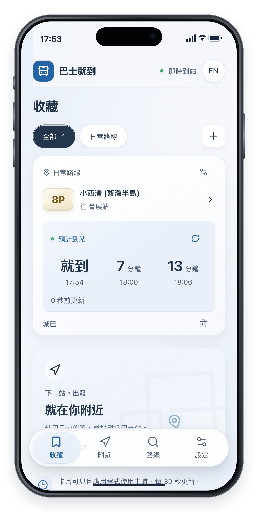
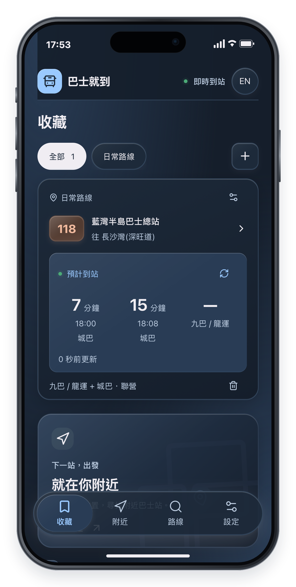
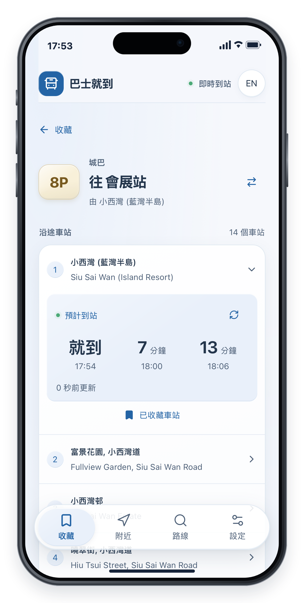
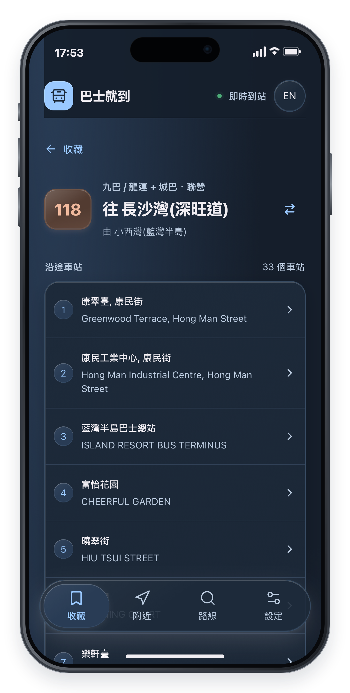

    

# Bus Coming · 巴士就到

Hong Kong bus arrival times for KMB / Long Win, Citybus and New Lantao Bus, in English and Traditional Chinese.

**[Open Bus Coming](https://buscoming.peterpo.com)**

On iPhone, open the app in Safari and choose **Share → Add to Home Screen**.

## A look inside

Keep favourite stops together, check upcoming arrivals and browse route stops in light or dark appearance.

|                                                     Saved stops · Light                                                      |                                                     Saved stops · Dark                                                     |
| :--------------------------------------------------------------------------------------------------------------------------: | :------------------------------------------------------------------------------------------------------------------------: |
|  |  |

|                                                Route stops and arrivals                                                 |                                                   Joint operator routes                                                    |
| :---------------------------------------------------------------------------------------------------------------------: | :------------------------------------------------------------------------------------------------------------------------: |
|  |  |

Screenshots show example data for demonstration.

## Everyday use

- **Routes:** search a route number, choose a direction and tap a stop for arrivals. Save stops for quick access.
- **Saved:** see your favourite stops together, organise them into named groups, or tap **Reorder** to change their order.
- **Nearby:** allow location access to find stops within 1 km. Your coordinates stay on your device.
- **Settings:** change language or theme colour, check downloads, refresh route data and export/import bookmarks.
  Blue is the default theme; light/dark appearance follows your device.

Downloaded routes work offline; live arrivals need an internet connection. Citybus search becomes available before
its full offline download finishes. Download progress is shown in Settings.

Bookmarks and preferences are stored locally, with no account or cloud sync. Export a backup in Settings before
switching devices or browsers. Safari and the installed Home Screen app may have separate storage.

To update, use **Settings → Check for app updates**, then **Update and reload** when offered. Finish any unsaved
edits first. Updates preserve saved data; there is no need to delete the app or clear website data.

Arrival estimates and route information come from [public operator data](https://data.gov.hk/en-datasets/category/transport)
and may change or be unavailable.

For contributors: [setup and deployment](docs/SETUP.md), [development guide](docs/DEVELOPMENT.md),
and [implemented behavior and limits](docs/REQUIREMENTS-AND-STATUS.md).
